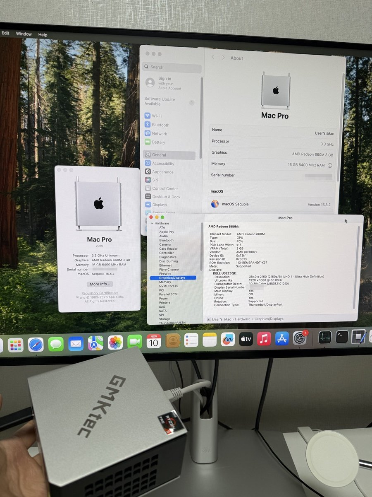
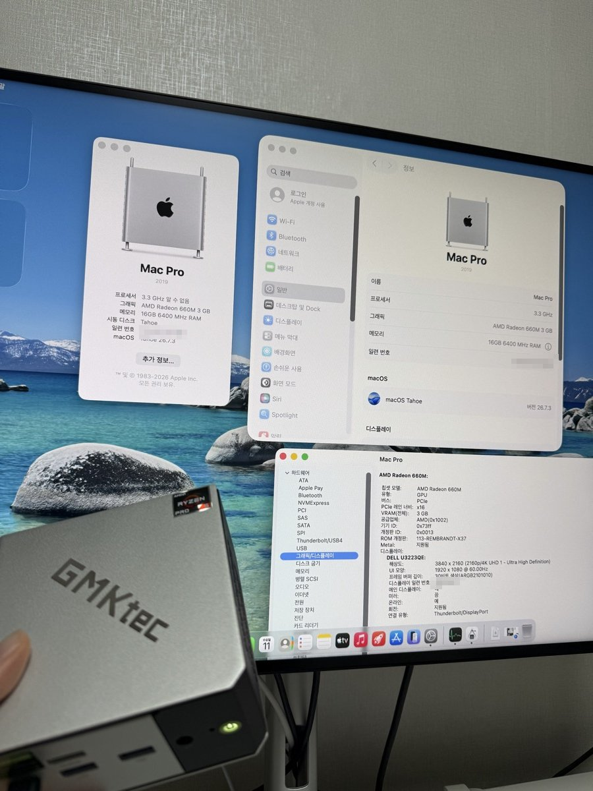

# GMKtec M8 해킨토시 (Ryzen 5 PRO 6650H, Radeon 660M)

| macOS 15.8.2 Sequoia | macOS 26.7.3 Tahoe |
|---|---|
|  |  |

같은 M8(앞의 본체)에서 두 OS를 각각 부팅한 화면. 그래픽이 AMD Radeon 660M으로 잡히고 Metal을 지원하며, 4K 모니터를 USB-C(DisplayPort)로 출력한다. 일련번호는 가렸다.

GMKtec NucBox M8 미니 PC에 **macOS 15.8.2 Sequoia**와 **macOS 26.7.3 Tahoe**를 같은 디스크에 함께 올리고, 내장 그래픽(Rembrandt)의 Metal 가속과 동영상 하드웨어 디코딩까지 살린 작업 기록이다. OpenCore 설정 하나로 두 OS를 다 부팅하고, 선택 화면에서 고른다. OpenCore 설정, 커널 확장 패치, 역분석 도구, 그리고 macOS에 없던 **AV1 하드웨어 디코딩**과 **VP9 하드웨어 디코딩**을 VideoToolbox에 붙인 디코더가 들어 있다.

이 저장소는 완성된 EFI 배포판이 아니다. 같은 기기나 같은 칩(Rembrandt, Radeon 660M과 680M)으로 작업하는 사람이 참고할 자료다. 커널 패치와 디코더의 일부는 두 macOS 빌드(15.8.2 `24H232`, 26.7.3 `25G342`)의 바이너리에 맞춰져 있어, 다른 빌드에서는 다시 확인해야 한다("버전에 묶인 것").

사람이 읽어도 되고, AI 에이전트에게 이 문서를 주고 자기 PC에서 같은 작업을 시켜도 되게 썼다. 각 단계에 배경, 절차, 검증 명령, 실패 시 대응이 있다. 이 작업을 에이전트에게 실제로 어떻게 시켰는지는 [`PROMPTS.md`](PROMPTS.md)에 모았다. 처음이라면 거기서 시작하면 된다.

> macOS 27은 x86에서 돌지 않는다. 커널은 x86_64판이 아직 들어 있지만 `launchd`, `WindowServer` 같은 사용자 공간이 Apple 실리콘 전용이다. 이 기기에서는 Tahoe가 마지막이다.

## 하드웨어

| 항목 | 내용 |
|---|---|
| 본체 | GMKtec NucBox M8, AMI BIOS `M8 V1.04` |
| CPU | AMD Ryzen 5 PRO 6650H (6코어 12스레드) |
| GPU | Radeon 660M (Rembrandt, PCI 1002:1681), VCN 3.1.2 |
| 유선랜 | Realtek RTL8125 2.5GbE 2개 |
| 무선 | MediaTek MT7922 (macOS 드라이버 없음, 동작 안 함) |
| USB | AMD xHCI 5개, USB4 |
| SMBIOS | MacPro7,1 (Sequoia와 Tahoe 모두 지원하는 기종) |

## 현재 상태

| 기능 | Sequoia 15.8.2 | Tahoe 26.7.3 |
|---|---|---|
| 부팅, Metal 가속, 4K 출력 | 동작 | 동작 |
| H.264, HEVC 하드웨어 디코딩 (VideoToolbox) | 동작. 1080p HEVC 약 330fps | 동작. 1080p HEVC 약 385fps, H.264 약 479fps |
| H.264, HEVC 하드웨어 인코딩 | 동작. H.264 202fps, HEVC 176fps (1080p, PSNR 45~46dB). HEVC Main10은 거부 | 동작. H.264 248fps, HEVC 203fps |
| AV1 하드웨어 디코딩 (8비트와 10비트) | 동작. Safari 유튜브 4K 60fps가 av01로 재생됨 | 동작(VideoToolbox, Chrome). Safari 유튜브는 확인하지 않음 |
| VP9 하드웨어 디코딩 (8비트와 10비트) | VideoToolbox 동작. Chrome은 Tahoe에서만 확인 | Chrome에서 동작. Safari는 서명 검증에 막혀 소프트웨어 디코딩 |
| JPEG 하드웨어 디코딩 | 안 됨 (커널 가속기에 JPEG 링이 없음) | 같음 |
| USB (키보드, 마우스, USB 랜) | 동작 (xHCI 핀 인터럽트 패치) | 동작 (Tahoe용 같은 패치) |
| USB 오디오 | 동작 (같은 패치로 팝핑 해결) | 확인하지 않음 |
| 유선랜 | 동작 (LucyRTL8125Ethernet, USB 랜은 기본 드라이버) | 동작 |
| Wi-Fi, 블루투스 | 안 됨 | 안 됨 |
| S3 잠자기 | 안 됨. 펌웨어의 S3 복귀가 OS와 무관하게 고장나 깨어나지 못함(단계 5). 잠자기를 꺼 두고 쓴다 | 같음 |
| 패닉 뒤 자동 재부팅 | 같은 코드(칩셋 리셋, `kext/panicreset.cpp`). 시험은 Tahoe에서 | 동작 (시험 패닉 후 50초에 재부팅) |
| 실기기 복구 모드, 설치 환경 | 뜨지 않음 (첫 설치 때 복구 이미지가 멈춤) | 뜨지 않음. 설치는 가상 머신이나 돌고 있는 macOS에서 한다(단계 0) |
| 장시간 안정성 | 일상 사용 | 10분 부하 시험 두 번 통과(AV1 디코딩 + Metal 계산 + 1GB 양방향 전송 동시) |

### 확인한 해상도 (Sequoia)

짧은 시험 영상을 해상도별로 만들어, 하드웨어 출력의 해시를 ffmpeg 소프트웨어 디코딩과 대조했다. Tahoe에서는 1080p로 H.264, HEVC, AV1(60프레임), VP9(120프레임)가 일치하는 것만 확인했다.

| 코덱 | 일치를 확인한 해상도 | 드라이버가 받는 한계 |
|---|---|---|
| AV1 | 1440p, 4K, 4096x2304, 5K, 7680x4320, 8192x4320 | 8192x4320 (높이 4352는 거부) |
| VP9 | 1440p, 4K, 4096x2304, 5K, 7680x4320, 8192x4320(타일 16열까지) | AV1 경로를 빌리므로 같음 |
| HEVC | 1080p, 10비트 1080p (그 이상은 대조하지 않음) | 4096x4096 |
| H.264 | 1080p (그 이상은 대조하지 않음) | 4096x2304 |

- VideoToolbox 경로로도 7680x4320의 AV1과 VP9가 일치했다.
- VP9에서 타일 열이 32개인 스트림(폭 8192에서만 가능)은 성공 상태로 검은 화면이 나와서, 디코더가 16열 초과를 거부하게 했다. 원인은 확인하지 못했다.
- 프레임당 시간(완료를 기다리는 동기 호출 기준): 1440p 11에서 13ms, 4K 15에서 18ms, 8K 36에서 39ms.

## 저장소 구성

| 경로 | 내용 |
|---|---|
| `configs/config.plist` | 지금 쓰는 OpenCore 1.0.5 설정. Sequoia와 Tahoe를 둘 다 부팅한다. 일련번호와 VBIOS는 빼 두었다 |
| `configs/config-wakedebug.plist` | S3 디버깅용 (디스크 로그와 자세한 로그를 켠 것) |
| `acpi/` | SSDT-PLUG, SSDT-EC-USBX |
| `kext/` | RembrandtGfx 커널 확장에 대한 패치. [원 프로젝트](https://github.com/caoshiyuan0211-blip/winmax2-2022-6800u-hackintosh)의 `src/RembrandtGfx`에 적용한다 |
| `scripts/` | ESP에 설정과 커널 확장을 설치하는 스크립트(`m8-apply-oc`), AV1/VP9 플러그인 이미지 관리(`m8-vtplugins`), SMU 메시지 도구(`m8-smu`), Ubuntu 라이브 SSH 자동 시작 |
| `tools/vtprobe` | VideoToolbox 하드웨어 디코딩 확인(`vtprobe`), 하드웨어 인코딩 확인(`vtenc`), Metal 계산 부하 시험(`mtlstress`) |
| `tools/avdprobe`, `tools/avdtrace` | AMD VA 드라이버 직접 호출과 호출 추적 |
| `tools/av1dec` | AV1 헤더 파서, 단독 디코더, VideoToolbox 디코더 번들(VP9 포함) |
| `tools/vp9dec` | VP9 헤더 파서, VCN용 VP9 메시지(Mesa에서 옮김), 단독 디코더, VideoToolbox 디코더, 빌드별 드라이버 주소(`vp9addr.h`) |
| `tools/re` | dyld 공유 캐시와 커널 컬렉션을 직접 파싱해 디스어셈블하는 스크립트 |
| `tools/hii` | AMI BIOS 설정 양식(HII) 파서. 메뉴에 안 보이는 설정 항목을 찾는다 |
| `docs/` | 작업 노트와 역분석 문서 (아래 "문서 목록") |
| `hardware/` | `lspci`, `/proc/cpuinfo` 출력 |

들어 있지 않은 것: OpenCore와 서드파티 커널 확장 바이너리, AMD 펌웨어, VBIOS, Apple 바이너리, 원본 로그, 시험 영상. 버전은 아래 "설정" 절에 적었다.

## 전제와 작업 구성

- 대상: GMKtec NucBox M8, 또는 같은 칩(AMD Rembrandt, Radeon 660M과 680M)을 쓰는 x86 PC. 다른 기기라면 절차의 순서와 진단 방법만 참고하고 값은 다시 구해야 한다.
- 기준 환경: OpenCore 1.0.5, macOS 15.8.2 (`24H232`, Darwin 24.6.0)와 26.7.3 (`25G342`, Darwin 25.6.0). 둘은 같은 APFS 컨테이너의 다른 볼륨에 있다. 둘 중 하나만 써도 된다.
- 각 단계는 목표, 절차, 검증, 실패 시 대응으로 되어 있다. 앞 단계의 검증을 통과한 상태가 다음 단계의 출발점이다. 단계마다 Sequoia와 Tahoe에서 다른 점을 따로 적었다.
- 이 저장소의 문서는 확인한 것과 미확인, 추정을 구분해 적었다.

| 역할 | 내용 |
|---|---|
| 작업용 컴퓨터 | 에이전트가 도는 곳. 여기서 빌드하고 SSH로 대상 PC를 다룬다. 이 기록에서는 Apple 실리콘 맥이었다. 맥이 아니거나 없어도 된다(아래) |
| 대상 PC | 유선랜으로 같은 네트워크에 연결. 유선랜 드라이버가 그래픽과 무관해서, 화면이 죽어도 SSH는 유지된다 |
| 사용자 | 대상 PC 앞에서 전원, BIOS, 화면 확인, 비밀번호 입력을 맡는다 |

이 기록에서는 대상 PC에 개발 도구를 깔지 않고, 작업용 맥에서 `clang -target x86_64-apple-macos13`으로 빌드해 `scp`로 보냈다. 개발 도구가 없는 macOS에서 `python3`를 실행하면 개발 도구 설치 창이 뜬다. zsh에서 `log`는 내장 명령이라 `/usr/bin/log`로 부른다.

### 작업용 컴퓨터별로 달라지는 것

macOS가 꼭 필요한 작업은 macOS 전용 도구 빌드뿐이다. 이것은 대상 PC가 macOS로 부팅된 뒤 대상 PC에서 빌드하면 된다(`xcode-select --install`로 Command Line Tools를 깐다).

| 작업 | 작업용 맥 | 작업용 리눅스나 윈도우(WSL) |
|---|---|---|
| 설치 (Ubuntu 라이브, QEMU) | 대상 PC 안에서 돈다. SSH만 있으면 된다 | 같다 |
| RembrandtGfx 빌드 | `make LD=ld` (Xcode 링커) | 원 프로젝트 방식: clang과 [cctools-port](https://github.com/tpoechtrager/cctools-port)의 ld64 |
| `tools/vtprobe`, `tools/av1dec`, `tools/vp9dec`, 플러그인 번들 | 교차 빌드 | 대상 PC에서 빌드 |
| SSDT 컴파일 | Homebrew `acpica` | `acpica-tools`의 `iasl` |
| `config.plist` 편집 | `PlistBuddy`, `plutil` | Python `plistlib`이나 ProperTree |
| `tools/re`(역분석) | Python과 capstone | 같다 |

### 작업용 컴퓨터가 없을 때

에이전트를 대상 PC 위에서 돌린다. 설치 단계는 Ubuntu 라이브 위에서, 이후는 macOS 위에서 돌린다. 이때 달라지는 것:

- 재부팅, 패닉, 그래픽 멈춤이 나면 에이전트도 같이 꺼진다. 진행 상황을 디스크의 메모 파일에 남기게 하고, 다음 부팅에서 대화를 이어 간다.
- 실패한 부팅은 볼 수 없으니 다음 부팅에서 읽는다. RembrandtGfx의 디스크 로그(`/private/var/log/rmb-msgbuf.log`, 이전 부팅 것이 이어 붙는다)와 `/Library/Logs/DiagnosticReports`의 패닉 보고서가 이 용도다. 두 OS를 다 깔았다면 한쪽이 안 뜰 때 다른 쪽으로 부팅해 그 볼륨의 로그를 읽을 수 있다.
- Ubuntu 라이브는 재부팅하면 사라진다. Ventoy의 영구 저장(persistence)을 쓰거나 작업 파일을 USB에 둔다.
- 되돌릴 길을 먼저 만든다. ESP의 이전 설정(`config-prev.plist`)을 OpenCore에서 고를 수 있게 하거나, Ubuntu USB로 들어가 되돌리는 방법을 사람이 알고 있어야 한다.

### 기기가 다를 때 먼저 볼 것

하드웨어를 덤프해 `hardware/`와 비교한다. 특히 다음이 다르면 해당 단계의 값을 다시 구한다.

- **유선 연결**: 그래픽이 죽어도 SSH가 살아 있으려면 macOS 기본 드라이버로 되는 유선 연결이 필요하다. 이 기록은 모니터의 USB 랜(CDC NCM)을 썼다. 무선만 있다면 USB 랜 어댑터부터 준비한다.
- 무선 카드(MT7922는 macOS 드라이버가 없다. Intel 카드면 itlwm 계열이 있다), 내장 유선랜 칩.
- GPU(660M과 680M, PCI 리비전), VBIOS, 노트북이라면 패널과 백라이트(원 프로젝트가 노트북이다).
- 디스크 컨트롤러(이 기록의 DRAM 없는 Maxio 컨트롤러 때문에 NVMeFix를 뺐다).
- 모니터 연결 방식(USB-C DP alt mode, HDMI), BIOS 버전과 숨은 설정(S3 결론은 이 기기의 펌웨어에 한한다).
- 다른 OS가 든 디스크. 지울 디스크는 모델명으로 지정하고, 나머지는 뽑아 두는 편이 안전하다.

## 작업하면서 알게 된 것

- 화면, 소리, LED는 원격에서 볼 수 없다. 사용자에게 묻거나 로그와 수치로 대신 확인했다.
- ESP에는 이전 설정과 이전 커널 확장을 백업해 두었다(`m8-apply-oc`가 `config-prev.plist`, `RembrandtGfx.prev`로 남긴다). 부팅이 안 될 때는 Ubuntu 라이브 USB로 들어가 이 백업으로 되돌렸다. 안정된 상태마다 ESP 전체도 압축해 따로 백업했다.
- 설정은 하나씩 바꾸는 편이 빨랐다. 부팅 인자 하나, 패치 하나를 바꾸고 재부팅해 검증하면 원인을 가를 수 있다.
- 커널 패치는 `MinKernel`/`MaxKernel`로 Darwin 버전을 나눠 두면 한 설정으로 두 OS를 부팅할 수 있다. 같은 패치라도 macOS 버전마다 바이트가 달라 따로 둬야 했다("버전별 커널 패치").
- 이 기기는 S3에서 깨어나지 못한다(펌웨어 문제, 단계 5에서 확정). 원격 작업 중 잠들면 사람이 가서 재부팅해야 한다. `sudo pmset -a sleep 0`으로 시스템 잠자기를 꺼 두면 된다.
- GPU가 멈추면 WindowServer 워치독 패닉(약 2분)을 기다리면 깨끗이 재부팅된다. 패닉 재부팅이 멈추는 문제는 `panicreset`으로 고쳤다.
- 익명 네임스페이스 안의 심볼을 다른 파일에서 참조하면 커널 확장이 로드되지 않고 사과 로고에서 멈춘다. 빌드 후 `nm -u RembrandtGfx | grep "^__Z" | c++filt`에 새 항목이 없어야 한다. Lilu로 같은 함수를 두 번 라우팅해도 패닉이 난다.
- `sudo`는 설치 스크립트 하나만 비밀번호 없이 실행되게 sudoers에 등록해 썼다(`scripts/m8-apply-oc`의 머리말 참고).
- DHCP 주소가 바뀔 수 있다. SSH 별칭이 안 붙으면 `dns-sd -B _ssh._tcp`로 대상 PC를 찾는다.
- `configs/`의 기기 식별 값(일련번호, MLB, UUID, MAC)과 VBIOS는 자리표시 값이다. 자기 기기의 값으로 채운다.

## 단계 0: 설치

설치 단계(설치 프로그램, 복구)의 시스템 이미지에는 Apple이 GPU 가속 드라이버를 넣지 않는다(화면 출력용 `AMDRadeonX6000Framebuffer`만 있다). 실기기에서 지금 EFI로 복구 모드를 띄우면 화면 펌웨어(DMUB)가 멈춰 뜨지 않고, 그래픽 커널 확장을 빼면 뜨지만 화면이 몇 초씩 걸려 그려진다(`docs/tahoe.md` 6절). 그래서 설치는 다음 둘 중 하나로 하고, 설치된 시스템을 지금 EFI로 실기기에서 부팅한다.

| 방법 | 언제 | 문서 |
|---|---|---|
| **가상 머신에서 설치**: 대상 PC를 Ubuntu 라이브로 부팅해 QEMU에 실기기 디스크 전체를 물려 설치 | 디스크가 비어 있을 때 (이 기록의 Sequoia) | `docs/install.md` |
| **돌고 있는 macOS에서 설치**: 같은 APFS 컨테이너에 볼륨을 만들고 설치 앱을 창으로 열어 그 볼륨을 고름 | 이미 macOS가 있을 때 (이 기록의 Tahoe) | `docs/tahoe.md` 1~3절 |

### 가상 머신에서 설치 (Sequoia)

`docs/install.md`에 실제로 실행한 명령과 함께 정리했다. 흐름은 이렇다.

1. Ventoy USB의 Ubuntu 라이브로 대상 PC를 부팅하고 SSH를 연다(`scripts/ventoy/`의 자동 시작 스크립트). 이후 모든 작업을 SSH로 한다.
2. 하드웨어를 덤프한다(ACPI 표, `dmidecode`, `lspci`, `dmesg`). SSDT와 VBIOS, 설정 값의 근거가 된다.
3. 대상 디스크를 ESP와 APFS용 파티션으로 나누고, ESP에 OpenCore와 macOS 복구 이미지(`macrecovery.py`)를 넣는다.
4. Ubuntu에서 QEMU 가상 머신을 띄우고 **실기기 디스크 전체를 그대로 물려** 설치한다. 화면과 입력은 QMP 소켓으로 원격 조작한다.
5. 같은 디스크를 실기기에서 OpenCore로 부팅한다. 실패하면 가상 머신으로 다시 부팅해 macOS 안의 로그를 읽는다.
6. 실기기 첫 부팅 문제 네 가지를 순서대로 고친다: MMIO 화이트리스트, NVMeFix 제거, MCE 리포터 차단(`kext/AppleMCEReporterDisabler.kext`), PCI 리비전을 Navi 23 값으로 보고.

사용자가 직접 해야 하는 것: USB 부팅, 가상 머신 안에서의 계정 생성과 원격 로그인 켜기.

Tahoe도 같은 방법으로 설치할 수 있을 것으로 본다(이 기록에서는 시험하지 않았다). 그 경우 "버전별 커널 패치"의 Tahoe용 패치가 실기기 부팅에 필요하다.

### 돌고 있는 macOS에서 설치 (Tahoe)

1. 같은 컨테이너에 볼륨을 만든다: `sudo diskutil apfs addVolume disk1 APFS Tahoe`.
2. `softwareupdate --fetch-full-installer --full-installer-version 26.7.3`으로 설치 앱을 받고, 창으로 열어 대상 디스크로 `Tahoe`를 고른다(`startosinstall`은 대상 볼륨을 고를 수 없다).
3. 설치 중 재부팅에서는 그래픽 커널 확장과 GPU 위장(`DeviceProperties`)을 뺀 설정으로 부팅했다. Tahoe용 커널 패치가 있어야 설치 커널이 디스크를 찾는다(`docs/tahoe.md` 2절).
4. 첫 설정 화면은 Sequoia에서 Tahoe의 Data 볼륨에 계정과 SSH를 미리 넣고 건너뛰었다(`docs/tahoe.md` 3절). 지금 EFI로 부팅하면 첫 설정 화면부터 가속이 붙을 것으로 보지만, 이 기록에서는 그 화면을 지금 EFI로 띄워 보지 않았다.

공통으로 쓰는 것: OpenCore 1.0.5, AMD 커널 패치(AMD Vanilla), Lilu 1.7.2, VirtualSMC 1.3.8, AmdTscSync 2.0.0, RestrictEvents 1.1.6, LucyRTL8125Ethernet 1.2.4, AppleMCEReporterDisabler.

검증: 대상 PC가 macOS로 부팅되고 작업용 컴퓨터에서 SSH로 접속된다.

```bash
ssh <M8> 'sw_vers; uname -a; nvram boot-args'
```

## 단계 1: 그래픽 가속 (RembrandtGfx)

그래픽은 RembrandtGfx(Lilu 플러그인)가 맡는다. macOS의 Navi 계열 드라이버(AMDRadeonX6000)를 Rembrandt에서 돌게 하는 커널 확장이고, 이 기기에서는 660M의 PCI 리비전을 Navi 23으로 보고하게 하는 패치를 더했다(`kext/rembrandtgfx-pci-revision.patch`).

목표: Metal 가속과 외부 모니터 출력.

절차:

1. [원 프로젝트](https://github.com/caoshiyuan0211-blip/winmax2-2022-6800u-hackintosh)를 받는다. 패치는 커밋 `a114bde`에 맞춰 만들었으므로 그 커밋을 받는다(`git checkout a114bde`). 더 새 커밋에서는 패치가 적용되지 않을 수 있다.
2. `kext/rembrandtgfx-m8.patch`를 적용하고 `kext/vcn.cpp`, `kext/panicreset.cpp`, `kext/mmhubremap.hpp`, `kext/mmhub2gc.hpp`를 `src/RembrandtGfx`에 넣는다.
3. 펌웨어를 linux-firmware의 `yellow_carp_*.bin`에서 원 프로젝트의 `scripts/fw-extract.py`로 뽑는다(Makefile의 `fw/toc.bin` 규칙). VCN 펌웨어 `fw/vcn.bin`은 이 스크립트가 만들지 않으므로 직접 만든다. linux-firmware의 `amdgpu/vcn_3_1_2.bin`(`yellow_carp_vcn.bin`이 이것을 가리키는 링크다)에서 앞 0x100바이트 amdgpu 헤더를 잘라낸다. 이 파일이 없으면 `fw.s`를 조립하는 단계에서 빌드가 멈춘다.

```bash
mkdir -p src/RembrandtGfx/fw && zstd -qdc <linux-firmware>/amdgpu/vcn_3_1_2.bin.zst | tail -c +257 > src/RembrandtGfx/fw/vcn.bin   # 압축되지 않은 파일이면 tail -c +257 <파일>
```

4. 빌드한다. 원 프로젝트의 Makefile은 cctools 링커를 기대한다(리눅스에서는 원 프로젝트 README대로 cctools-port를 쓴다). 맥에서는 Xcode의 링커로도 된다.

```bash
make LD=ld
```

5. 대상 PC의 VBIOS를 뽑아 OpenCore 설정의 `DeviceProperties`에 `ATY,bin_image`로 넣는다(원 프로젝트의 `scripts/vfct-rom.py`, `augment-rom.py`). 자세한 것은 `docs/install.md`.
6. 부팅 인자에 `-lilubetaall`을 넣는다. Lilu가 정식 지원으로 표시하지 않은 macOS에서도 플러그인을 올리게 한다. Tahoe에서는 이것이 없으면 RembrandtGfx가 올라오지 않는다. 같은 설정을 Sequoia에도 쓴다.
7. `scripts/m8-apply-oc`로 ESP에 설치하고 재부팅한다. 이 스크립트는 대상 PC의 macOS 계정 이름이 `user`이고 작업 폴더가 `/Users/user/m8`이라고 가정한다. 다른 이름이면 스크립트 머리의 `D=` 경로를 고친다. 커널 확장 안의 경로(`/Users/user/m8/...`)는 `kext/vcn.cpp`와 통합 패치의 `sleep.cpp` 부분에 있고, 기본 부팅 인자로는 쓰이지 않는다(`-rmbvcnarm`, `-rmbvcnexp`, `-rmbphysdump`를 넣었을 때만).

검증:

```bash
ssh <M8> 'ioreg -l -w0 | grep -E "MetalPluginName|IOClass.*GraphicsAccelerator"'
```

`AMDRadeonX6000MTLDriver`와 `AMDRadeonX6000_AMDNavi23GraphicsAccelerator`가 나와야 한다. 계산 결과까지 확인하려면 `tools/vtprobe/mtlstress.m`(해시 계산을 CPU와 대조)을 돌린다.

Sequoia와 Tahoe의 차이: 커널 확장이 찾는 심볼 194개와 VCN 관련 오프셋이 Tahoe에서도 같아, 같은 바이너리가 그대로 동작한다. Tahoe에서는 디스크 로그를 `-rmbnodisklog`와 무관하게 항상 남긴다(실패한 부팅을 읽기 위해).

실패 시: 화면이 안 나와도 SSH는 된다. 디스크 로그(`/private/var/log/rmb-msgbuf.log`)를 본다. 한쪽 OS가 안 뜨면 다른 쪽으로 부팅해 `/Volumes/<볼륨> - Data/private/var/log/rmb-msgbuf.log`를 읽는다.

## 단계 2: H.264, HEVC 하드웨어 디코딩과 인코딩

`-rmbvcn` 부팅 인자로 켠다. 그냥 켜면 VCN이 GPU 전체를 멈추게 했고, 원인과 수정은 다음과 같다. 레지스터 지도, 헛다리, 디버깅 기법은 `docs/vcn-h264-hevc-bringup.md`에 있다.

1. VCN이 전원 게이트돼 있어 SMU로 켠다.
2. HWLibs가 Navi의 MMHUB 2.0 레지스터 주소 표를 쓰는데 Rembrandt는 MMHUB 2.3이라 무효화 대기가 끝나지 않았다. 표를 이름 기준으로 2.3 주소로 바꾼다.
3. HWLibs에는 VCN 3.0 펌웨어만 있어, Rembrandt용 VCN 3.1.2 펌웨어(linux-firmware)를 그 자리에 넣는다.
4. 가속기가 채우는 MM hub VM 레지스터 주소도 2.3으로 바꾼다.
5. `MMMC_VM_MX_L1_TLB_CNTL`의 `ENABLE_ADVANCED_DRIVER_MODEL`이 꺼져 있어 출력이 검은 화면이었다. 이 비트를 켠다.
6. 디코딩 완료 인터럽트가 가속기에 도착하지 않아 프레임당 16.7 또는 33.3ms가 걸렸다(초당 30프레임). 완료를 기다리는 것이 있으면 1ms마다 타임스탬프를 확인하는 스레드를 넣었다(`stampPoll`). 근본 원인은 아직 모른다. 이후 대조 시험에서는 stampPoll을 꺼도 33ms 멈춤이 재현되지 않았고, 켰을 때의 이득은 처리량 7에서 12%였다. 비용이 작아 켜 둔다.
7. 화면이 켜져 있으면 전원 관리 펌웨어(SMU)가 VCN 클럭을 최저(VCLK/DCLK 400MHz)에 묶어 디코딩이 화면을 끈 상태의 절반 이하로 느려졌다. 디코딩 링에 작업이 들어오는 동안 SMU에 VCN 최소 클럭(`SetHardMinVcn`)을 최대로 걸고, 3초 유휴 후 푼다(`smu.cpp`의 vcnboost). `sysctl debug.rmb_vcnboost`로 0 끔, 1 자동(기본), 2 항상. 움직이는 배경화면은 VCN으로 계속 디코딩하므로 그 경우 화면이 켜져 있는 동안 하한이 계속 걸린다.
8. VCN이 꺼져 있으면(부팅 인자가 없거나 `-rmbnovcntahoe`) 하드웨어 코덱 광고를 숨긴다. 숨기지 않으면 앱이 응답하지 않는 VCN에 일을 보내 2초마다 GPU가 재시작되다 WindowServer 워치독 패닉이 난다(Tahoe에서 겪음, `docs/tahoe.md` 4.2).

목표: VideoToolbox가 H.264와 HEVC를 하드웨어로 디코딩하고 인코딩한다.

절차: 부팅 인자에 `-rmbvcn`을 넣는다. 필요한 수정은 `kext/vcn.cpp`에 들어 있다. 다른 기기나 다른 빌드에서 VCN이 멈추면 `docs/vcn-h264-hevc-bringup.md`의 기법(레지스터 추적, 한 번만 켜는 모드, 멈춤 덤프)부터 쓴다.

검증: `tools/vtprobe`를 빌드해 올린다. H.264나 HEVC로 인코딩한 짧은 mp4가 필요하다(ffmpeg로 아무 영상이나 만들면 된다).

```bash
clang -target x86_64-apple-macos13 -fobjc-arc -O1 -o vtprobe tools/vtprobe/vtprobe.m -framework Foundation -framework AVFoundation -framework VideoToolbox -framework CoreMedia -framework CoreVideo -framework CoreImage -framework ImageIO
```

```bash
ssh <M8> './vtprobe query; ./vtprobe check test-hevc.mp4 60; ./vtprobe decode test-hevc.mp4 240'
```

- `query`가 `h264 hardware decode: YES`, `hevc hardware decode: YES`를 낸다.
- `check`가 하드웨어와 소프트웨어 출력의 밝기 차이를 낸다. 0에 가까워야 한다. 하드웨어 출력의 평균 밝기가 16 근처면 검은 화면이 나오는 것이다(`ENABLE_ADVANCED_DRIVER_MODEL` 문제를 의심한다).
- `decode`가 초당 프레임 수를 낸다. 정확히 영상의 프레임률이나 30으로 나오면 완료 통지가 늦는 것이다. 디스크 로그에서 `stamppoll: installed`를 찾는다. 1080p HEVC 기준으로 Sequoia 약 300에서 330, Tahoe 약 385프레임이 나왔다. 화면이 켜진 상태에서 130프레임 근처면 클럭 하한이 걸리지 않은 것이다. `sysctl debug.rmb_vcnboost_ons`가 늘어나는지, `scripts/m8-smu`로 SMU 상태를 본다.

인코딩은 `tools/vtprobe/vtenc.m`으로 확인한다(`vtenc query`, `vtenc encode SRC h264|hevc N OUT.mov`). 하드웨어 전용 세션을 만들 수 있어야 하고, 출력 파일을 원본과 PSNR로 비교한다.

실패 시: VCN이 멈추면 GPU 전체가 멈출 수 있다. 이때는 워치독 패닉(약 2분)을 기다리면 재부팅된다. `-rmbvcn`을 빼고 부팅하면 디코딩 없이 돌아간다. 부팅 자체가 안 되면 Ubuntu 라이브 USB로 들어가 ESP의 `RembrandtGfx.prev`와 `config-prev.plist`로 되돌린다.

## 단계 3: USB (핀 인터럽트)

증상: Sequoia에서는 USB 스피커 소리가 약 256ms마다 끊기고 커널 로그에 `AppleUSBAudio ... Output Fell Behind`가 반복됐다. Tahoe에서는 더 심해서, USB에 붙은 키보드, 마우스, USB 랜이 몇 초씩 밀렸다(네트워크 왕복 2에서 8초).

원인: AMD xHCI가 MSI 벡터 1개 상태에서 인터럽트를 제때 올리지 않는다.

절차: `AppleUSBXHCIPCI::start`에서 MSI 대신 핀 인터럽트를 쓰게 하는 커널 패치를 쓴다. 구조는 두 버전이 같고 점프 거리만 달라 패치를 버전별로 둔다("버전별 커널 패치"). 다른 빌드에서는 `AppleUSBXHCIPCI::start`를 디스어셈블해 첫 `getInterruptType(0)` 뒤의 조건 분기를 다시 찾는다(`docs/usb-audio-popping.md`).

검증:

```bash
ssh <M8> '/usr/bin/log show --last 1m --predicate "eventMessage CONTAINS \"Fell Behind\"" | wc -l; ioreg -l -w0 | grep -c IOPCIMSIMode; ping -c 5 <작업용 컴퓨터>'
```

재생 중 `Fell Behind`가 없어야 하고, 같은 LAN의 왕복 시간이 몇 ms여야 한다. 소리가 깨끗한지는 사용자에게 묻는다(Tahoe의 USB 오디오는 아직 확인하지 않았다).

위험: 핀 인터럽트가 동작하지 않으면 USB 전체가 죽는다. 내장 유선랜(LucyRTL8125)으로도 SSH가 되도록 해 두면 되돌릴 수 있다.

## 단계 4: AV1 하드웨어 디코딩

macOS는 인텔 맥에서 AV1 하드웨어 디코딩을 제공하지 않는다. 그런데 AMD의 유저랜드 VA 드라이버(`AMDRadeonVADriver2`) 안에는 AV1 디코드 처리기(`AvdVcnAv1DecDataProcessor`)가 들어 있고, Navi 23으로 보이는 기기에서 기능으로 광고된다. 호출하는 쪽(AppleGVA, VideoToolbox)이 없을 뿐이다. 그래서 다음을 만들었다.

1. **드라이버 직접 호출**: `AVD_CreateAVDAccelerator`가 돌려주는 함수 표를 직접 부른다. 기존 HEVC 디코딩의 호출 순서를 `avdtrace`로 추적해 구조체 배치를 얻었다.
2. **AV1 입력 구조체 역분석**: 처리기가 기대하는 시퀀스 헤더, 프레임 헤더, 타일 구조체의 배치를 디스어셈블로 풀었다. 드라이버가 만드는 메시지는 Mesa의 `rvcn_dec_message_av1_t`와 오프셋이 일치한다(`docs/avd-av1-picparam-layout.md`, `docs/avd-decode-command-layout.md`).
3. **AV1 헤더 파서와 단독 디코더**: `tools/av1dec/av1hdr.c`, `av1dec.c`. 1080p, 4K 타일 8개, 필름 그레인 영상이 ffmpeg 소프트웨어 디코딩과 화소 단위로 일치했다.
4. **VideoToolbox 디코더**: `tools/av1dec/av1vt.c`. 비공개 VTVideoDecoder 인터페이스를 구현한 번들이다. 하드웨어 가속으로 표시해 등록해야 av01 세션에서 선택된다.
5. **시스템 등록**: `/Library/Video/Plug-Ins`의 번들은 Apple 서명이 있어야 로드된다. 서명 검사가 없는 곳은 봉인된 `/System/Library/Video/Plug-Ins`뿐이라, 원본 플러그인 사본과 이 번들을 담은 읽기 전용 디스크 이미지를 그 경로 위에 마운트한다(`scripts/m8-vtplugins`). 시스템 볼륨의 봉인은 건드리지 않고, 언마운트하면 원래대로 돌아간다. SIP의 파일 시스템 보호가 꺼져 있어야 한다.

결과: `VTIsHardwareDecodeSupported('av01')`가 참이 된다. Sequoia에서 Safari 18.6의 유튜브가 4K 60fps를 av01로 재생했다(프레임당 8에서 9ms, 360프레임 구간당 누락 0에서 1개). Tahoe에서는 VideoToolbox와 Chrome에서 확인했다.

자세한 경과와 수치는 `docs/worklog-av1-s3.md`에 시간순으로 있다.

### 절차와 검증

목표: `VTIsHardwareDecodeSupported('av01')`가 참이 되고 브라우저가 av01을 하드웨어로 재생한다. 전제는 단계 2가 끝난 것이다.

1. 드라이버가 AV1을 광고하는지 확인한다.

```bash
clang -target x86_64-apple-macos13 -O1 -o avdprobe tools/avdprobe/avdprobe.c -framework IOKit -framework CoreFoundation
```

```bash
ssh <M8> './avdprobe'
```

`decode AV1` 줄(funcId 1, subId 0x1000000)이 있어야 한다. 없으면 드라이버가 이 기기를 AV1 지원 기종으로 보지 않는 것이다(Navi 2x로 위장하지 않았거나 드라이버가 다른 버전이다).

2. 단독 디코더로 화소 단위 검증을 한다. 시험 영상은 SVT-AV1 등으로 만든다(8비트 4:2:0, `-f obu`).

```bash
cd tools/av1dec && make
```

```bash
ssh <M8> './av1dec test-av1.obu 120 out.nv12'
```

출력을 가져와 ffmpeg의 소프트웨어 디코딩과 비교한다(`tools/av1dec/cmp.py`). 모든 프레임에서 차이가 0이어야 한다.

3. VideoToolbox 디코더 번들을 시스템에 등록한다. root가 필요하다. 이미지는 **OS마다 그 OS에서 따로 만든다.** 이미지 안에 그 OS의 Apple 플러그인 사본이 들어가므로, 빌드 번호가 다른 이미지는 스크립트가 마운트하지 않는다. macOS를 업데이트한 뒤에도 다시 만든다.

```bash
ssh <M8> 'sudo ./m8-vtplugins build AV1AMDDecoder.bundle && sudo ./m8-vtplugins install'
```

`install`은 부팅 때 이미지를 마운트하는 LaunchDaemon을 등록한다. 이미지를 바꿀 때 디코더 서비스(`VTDecoderXPCService`)가 이전 이미지를 잡고 있으면, 스크립트가 그 서비스를 멈춘 뒤 교체한다.

검증:

```bash
ssh <M8> './vtprobe query; ./vtav1test test-av1.mp4 120 - system'
```

`av1 hardware decode: YES`가 나오고 `vtav1test`가 프레임을 디코딩한다. Safari는 완전히 종료했다 다시 열어야 새 플러그인 목록을 읽는다. 유튜브의 통계에서 코덱이 `av01`인지 사용자에게 확인을 부탁하고, 로그로도 본다.

```bash
ssh <M8> '/usr/bin/log show --last 5m --predicate "eventMessage CONTAINS \"AV1AMD\"" | tail -3'
```

알아둘 것:

- `/Library/Video/Plug-Ins`에 넣는 방식은 통하지 않는다. CoreMedia가 그 경로의 번들에 Apple 서명을 요구한다.
- 디코더를 직접 시험할 때 VideoToolbox가 디코딩을 별도 프로세스(VTDecoderXPCService)로 보내면 프로세스 내 훅이나 등록이 먹지 않는다. `defaults write com.apple.coremedia VTDecodeServer -string never`로 프로세스 내 디코딩을 강제하고, 끝나면 지운다.
- 원격에서 `pmset sleepnow` 같은 지연 명령을 걸 때는 `nohup`으로 걸고, 실제로 실행됐는지 결과로 확인한다. SSH가 닫히면 백그라운드 명령이 같이 죽을 수 있다.

## 단계 4-2: VP9 하드웨어 디코딩

AMD VA 드라이버에는 VP9 처리기가 없다. 칩과 펌웨어는 VP9를 지원하므로, 드라이버의 AV1 경로를 빌려 VP9 메시지를 보낸다. 전제는 단계 4가 끝난 것이다.

원리:

1. 드라이버에게 AV1 디코더를 만들게 한다. 버퍼 할당, 명령 제출, 완료 처리는 드라이버가 그대로 한다.
2. 자기 프로세스 안에서 `AvdVcnAv1DecDataProcessor`의 가상 함수 표에서 세 개를 바꾼다.
   - `ProcessCreateDecodeSession`: 세션 생성 메시지의 스트림 종류를 AV1(0x13)에서 VP9(0x11)로 바꾼다.
   - `initHWContext`: 문맥 버퍼에 VP9의 기본 확률 표를 쓴다.
   - `SetDecodeMessageFields`: 드라이버가 만든 디코드 메시지에서 AV1 메시지 항목을 VP9 메시지로 바꾸고, 확률 버퍼에 VP9 표를 쓴다.
3. VP9 메시지 형식과 기본 확률 표는 Mesa(`ac_vcn_dec.h`, `radeon_vcn_dec.c`)에서 옮겼다(`tools/vp9dec/vcn_vp9.h`, `vp9_probs.h`, `vp9msg.h`).
4. 드라이버 안의 함수 주소는 macOS 빌드마다 다르다. `tools/vp9dec/vp9addr.h`에 `24H232`(Sequoia)와 `25G342`(Tahoe)의 값이 있고, 실행 중인 빌드(`kern.osversion`)의 값을 골라 가상 함수 표가 기대와 같은지 확인한 뒤에만 바꾼다. 표에 없는 빌드에서는 VP9를 끈다. 구조체 오프셋은 두 빌드에서 같았다(세 함수의 디스어셈블을 비교). 새 빌드의 값은 머리말의 `tools/re/dsc.py` 명령으로 구한다.

절차와 검증:

```bash
make -C tools/vp9dec vp9dec
```

```bash
ssh <M8> './vp9dec test-vp9.ivf 120 out.nv12'
```

시험 영상은 libvpx로 만든 8비트 4:2:0 ivf다. 출력을 ffmpeg의 소프트웨어 디코딩과 비교한다(`tools/av1dec/cmp.py`). Sequoia에서 1080p 120프레임, 타일 4열 1080p, 4K 모두 차이가 0이었고 프레임당 3ms(1080p), 8에서 9ms(4K)였다. Tahoe에서도 1080p 120프레임이 바이트 단위로 같았다.

VideoToolbox 쪽은 `tools/av1dec`의 번들에 같이 들어간다(`make`가 `vp9vt.c`를 함께 빌드한다). 설치는 단계 4와 같다. VP9는 보조 디코더라, 클라이언트가 먼저 요청해야 목록에 들어간다.

```bash
ssh <M8> 'CODEC=vp09 SUPP=1 ./vtav1test test-vp9.mp4 120 - system'
```

`VTIsHardwareDecodeSupported(vp09) = 1`이 나오고 프레임이 디코딩된다.

### 브라우저: Chrome은 되고 Safari는 안 된다

- **Safari**: VideoToolbox 안에 "이 코덱은 요청한 프로세스 안에서 디코더를 연다"는 목록이 박혀 있다(`avc1`, `vp09` 등, `av01`은 없음). 이 동작은 `com.apple.developer.videotoolbox.client-sandboxed-decoder` 권한이 있는 프로세스에만 해당하는데, Safari의 GPU 프로세스가 그 권한을 가진 Apple 플랫폼 바이너리다. 그래서 VP9 번들이 Safari 프로세스 안에 올라가려다 라이브러리 검증에 걸리고(`mapping process is a platform binary, but mapped file is not`), WebKit은 내장 libvpx로 넘어간다. 플랫폼 바이너리에는 Apple이 직접 서명한 코드만 올라가므로 Apple 개발자 계정으로 서명해도 풀리지 않는다. 두 버전 모두 같다.
- **Chrome**: 그 권한이 없어서 VP9도 AV1처럼 시스템 디코더 서비스(`VTDecoderXPCService`)로 가고, 거기서는 이 번들이 올라간다. Tahoe의 Chrome 157에서 DevTools의 미디어 정보가 `kVideoDecoderName = VideoToolboxVideoDecoder`, `kIsPlatformVideoDecoder = true`였고, 디코더 서비스가 `VP9AMD: startSession 1920x1080`을 남겼다. 1080p30 VP9를 60초 재생해 1965프레임 중 4프레임 누락, Chrome GPU 프로세스 CPU 6%, 디코더 서비스 2%였다. Chrome은 AV1도 같은 경로로 하드웨어 디코딩한다. Sequoia의 Chrome은 시험하지 않았지만 같은 경로다.
- 유튜브는 하드웨어 AV1을 지원하는 브라우저에 AV1을 먼저 준다. VP9 하드웨어 디코딩이 실제로 쓰이는 것은 AV1 버전이 없는 영상이다.

알아둘 것:

- 가상 함수 표를 바꾸면 그 프로세스의 모든 AV1 디코더에 걸린다. 그래서 훅은 VP9 세션이 드라이버를 부르는 동안의 스레드에서만 동작하고, 나머지는 원래 함수로 넘긴다.
- Mesa는 이 세대의 VCN에서 동적 DPB를 쓰지만, 드라이버가 AV1용으로 잡는 고정 DPB로도 동작했다.
- 세그멘테이션이나 숨은 참조 프레임이 든 스트림, 스트림 중간의 해상도 변경은 시험하지 않았다.

## 단계 5: S3 잠자기 (안 됨, 펌웨어 문제로 확정)

결론부터: 이 BIOS(AMI, `M8 V1.04`)의 S3 복귀가 동작하지 않는다. OS와 무관하며 macOS에서 고칠 수 없다. 두 버전 모두 잠자기를 꺼 두고(`pmset -a sleep 0`) 쓴다. 아래 실험은 Sequoia에서 했다.

펌웨어는 Modern Standby 전용으로 출하돼 `_S3`이 `XS3`로 숨겨져 있고 `SS3 = 0`이다. `configs/config.plist`의 ACPI 패치 두 개(`XS3 to _S3`, `SS3 Zero to One`)로 되살리면 macOS가 S3로 들어간다. 잠들기는 끝까지 되지만(그래픽 드라이버의 잠자기 처리까지 로그가 남고 팬이 멎는다), 전원 버튼을 눌러도 화면과 네트워크가 돌아오지 않는다. 팬은 다시 돈다.

### 어디서 멈추는지 (wakecrumb)

커널이 깨어나는 경로에 단계 표시를 심어 어디까지 가는지 확인했다. `wakecrumb`가 각 단계 번호를 RTC CMOS에 적고(강제 전원 차단 뒤에도 남는다), 다음 부팅에서 디스크 로그로 읽는다.

- `0x51` 잠자기 알림 → `0x52` 커널의 `acpi_sleep_kernel` 진입 → `0x53` 그 함수에서 복귀 → 그 뒤 드라이버 복구.
- 펌웨어가 OS의 깨우기 진입점(실모드 wake vector, 물리 0x2000)과 보호모드 진입점에도 단계(`0x56`, `0x57`)를 심었다.

측정 결과 네 칸 모두 `0x52`에서 멈췄고 `0x53`도 `0x56`도 찍히지 않았다. **즉 커널은 잠자기 함수에 들어간 뒤 돌아오지 못하고, 펌웨어는 OS의 깨우기 진입점까지 오지도 않는다.** 그래픽 드라이버 복구 문제가 아니다(거기까지 가지 못한다).

주의: 펌웨어가 CMOS 0x58/0x59를 자기 용도로 덮어쓴다. 그래서 단계 값을 서로 떨어진 여러 칸에 중복으로 적고 부팅 때 256바이트를 전부 덤프해 어느 칸이 살아남는지 본다.

```bash
ssh <M8> 'sudo tail -c 3000000 /private/var/log/rmb-msgbuf.log | grep -a "wakecrumb: cell" | tail -6'
```

### BIOS 설정과 리눅스 대조

메뉴에 안 보이는 BIOS 설정에 S3/Modern Standby 전환 항목이 있다. 펌웨어가 설정 양식(HII)을 메모리에 내보내고 NVRAM 변수 `…:HiiDB`에 그 크기와 주소를 두는데, 이걸 `nvram`으로 읽고, 커널 확장에 넣은 물리 메모리 덤프 기능으로 그 영역을 파일로 떠서 설정 양식을 분석했다(`tools/hii`에 파서와 이 기기의 결과 예시). 항목은 `AMD_PBS_SETUP` 변수의 한 바이트이고, macOS에서 그 바이트만 바꿔 쓸 수 있다.

S3 Enable로 바꾸면 펌웨어가 실제로 S3 모드로 전환된다(ACPI 표에서 확인: FADT의 Low Power S0 Idle이 꺼지고 `_S3`이 숨김 없이 노출). 그런데도 깨우기는 같은 지점에서 실패했다. Ubuntu 라이브로 부팅해 `rtcwake -m mem`으로 S3를 걸어도 돌아오지 않았다. **OS를 바꿔도 안 되므로 펌웨어의 S3 복귀 경로가 고장난 것으로 확정했다.** (시험 뒤 설정은 원래 값으로 되돌렸다.)

같은 Rembrandt SoC의 다른 기기(GPD Win Max 2, 원 프로젝트)에서는 S3가 된다고 하므로, SoC가 아니라 이 보드 펌웨어의 문제다. 고치려면 제조사의 BIOS 업데이트가 필요하다. 새 BIOS가 나오면 같은 도구로 바로 재시험할 수 있다.

### 이어서 할 사람을 위한 메모

- 실험은 실패할 때마다 강제 전원 차단이 필요하다. 사람 없이 반복하려면 원격 전원 제어(스마트 플러그 + BIOS의 전원 복구 시 자동 켜짐)가 있어야 한다.
- `wakecrumb`와 깨우기 벡터 기록은 커널 확장에 들어 있고 `-rmbwakecrumb` 부트인자가 있을 때만 동작한다(없으면 CMOS를 건드리지 않는다). 물리 메모리 덤프는 `-rmbphysdump`가 있을 때만 동작한다.

## 단계 6: 패닉과 안정성

두 버전에 공통인 안정화 항목이다. Tahoe에서 먼저 드러났다.

- **패닉 뒤 재부팅되지 않고 멈춤**: 이 기기의 ACPI 재시작 레지스터는 펌웨어 SMI(포트 `0xB2`)다. GPU가 돌고 있을 때 패닉이 나면 이 재시작에서 멈췄다. 커널 확장이 패닉 재시작(`PEHaltRestartInternal`의 type 4, 9)을 가로채, 플랫폼 패닉 동작까지 원래대로 돌린 뒤 칩셋 리셋 레지스터 `0xCF9`로 콜드 리셋한다(`kext/panicreset.cpp`). Tahoe에서 AV1 디코딩과 Metal 부하 중 시험 패닉(`sudo sysctl -w debug.rmb_panic=0x7061`)을 내자 50초 만에 스스로 재부팅했다. 같은 함수가 Sequoia 커널에도 있어 같은 코드가 걸리지만, Sequoia에서는 시험하지 않았다. `-rmbnopanicreset`로 끈다.
- **부하 중 네트워크 패닉 (Tahoe)**: Tahoe 커널에 새로 생긴 `now >= *pkt_enq_time` 검사(`classq_fq_codel.c`)가 코어 간 TSC 어긋남 때문에 하드웨어 디코딩과 대용량 전송을 함께 할 때 패닉을 냈다. Sequoia 커널에는 이 검사가 없다. Tahoe용 커널 패치로 음수 대기 시간을 "목표 이하" 경로로 보낸다(`docs/tahoe.md` 4.3).
- **부하 시험**: `tools/vtprobe/mtlstress`(Metal 계산 결과를 CPU와 대조), AV1 하드웨어 디코딩 반복, 1GB 양방향 전송을 10분 동시에 돌려 오류와 GPU 재시작이 없는지 본다.

```bash
ssh <M8> 'grep -acE "not expired|fRestartType" /private/var/log/rmb-msgbuf.log; ls -t /Library/Logs/DiagnosticReports | head -3'
```

## 버전별 커널 패치

`configs/config.plist` 하나에 두 버전의 패치를 함께 두고 `MinKernel`/`MaxKernel`로 나눈다. 원래 패치는 Darwin 24(Sequoia)로 제한하고, Tahoe용은 Darwin 25로 제한했다. 바이트 값과 찾은 과정은 `docs/tahoe.md` 2절과 4절에 있다.

| 패치 | Sequoia (Darwin 24) | Tahoe (Darwin 25) |
|---|---|---|
| IOPCIFamily `probeBusGated` 10비트 태그 끄기 | 원래 패치 (`bt r14d,0x11; jb`) | 분기가 뒤집혀(`bt ebx,0x11; jae`) 원래 패치가 맞지 않음. `jae`를 무조건 점프로 바꾸는 패치. 없으면 NVMe와 유선랜이 레지스터를 전부 1로 읽고 `Still waiting for root device` |
| `thread_invoke`, `thread_dispatch` 시간 역행 패닉 제거 | 원래 패치 (스레드 필드 `0x488`) | 필드가 `0x490`으로 옮겨져 원래 패턴이 엉뚱한 함수(`_vmx_hv_support`)를 고침. 다시 만든 패턴 |
| `AppleUSBXHCIPCI::start` 핀 인터럽트 | M8용 패치 | 점프 거리만 다른 패치 (`jne` 거리 0x268) |
| `fq_codel` 시간 순서 검사 | 해당 없음 (검사가 없음) | `jb +0x74`(assert) → `jb +0x52`(목표 이하 경로) |

AMD Vanilla의 CPU 관련 패치와 MCE 리포터 차단, 패닉 재시작(`panicreset`)은 두 버전에 공통이다.

새 빌드로 업데이트하면 각 Find가 커널 컬렉션에서 의도한 함수에 정확히 한 번 맞는지부터 확인한다(`tools/re/kcdis.py`).

## 역분석 도구

대상 PC의 바이너리를 작업용 컴퓨터로 가져와 분석한다. 두 버전 모두 경로는 같다.

- 커널: `/System/Library/KernelCollections/BootKernelExtensions.kc`(커널과 부팅 때 필요한 확장), `SystemKernelExtensions.kc`(그 밖의 확장). 파일셋 형식이고 심볼이 남아 있다. `tools/re/kcdis.py`.
- 유저랜드: `/System/Volumes/Preboot/Cryptexes/OS/System/Library/dyld/dyld_shared_cache_x86_64h*` (약 5GB). `tools/re/dsc.py`가 캐시를 직접 파싱한다. 최신 macOS의 `dsc_extractor`는 이 캐시를 서명 검사로 거부했다.

```bash
DSC_DIR=dl/dsc python3 tools/re/dsc.py syms 'AMDRadeonVADriver2$' 'Av1'
```

```bash
DSC_DIR=dl/dsc python3 tools/re/dsc.py dis 'AMDRadeonVADriver2$' _AVD_CreateAVDAccelerator
```

capstone이 필요하다. 버전 간에 함수가 바뀌었는지는 두 빌드의 디스어셈블을 주소만 지우고 비교하면 빠르다(VP9 주소 표가 그렇게 만들어졌다). 동적 추적은 `tools/avdtrace`가 예시다. 자기 프로세스 안에서 드라이버 함수의 앞부분을 덮어써 가로채고 인자를 덤프한다.

## 버전에 묶인 것

다른 macOS 빌드에서는 아래를 다시 확인한다. 하나라도 어긋나면 멈추거나 잘못된 출력이 나온다. 확인한 빌드는 `24H232`와 `25G342`다.

| 항목 | 위치 | 확인 방법 |
|---|---|---|
| 버전별 커널 패치 (10비트 태그, 시간 역행, xHCI, fq_codel) | `configs/config.plist` | 각 Find가 커널 컬렉션에서 의도한 함수에 정확히 한 번 나오는지 |
| `stampPoll`의 vtable 오프셋 0x3b0, 필드 0xd38 | `kext/vcn.cpp` | `AMDAccelEventMachine::waitForStamp`를 디스어셈블해 같은 접근이 있는지 (두 빌드에서 바이트까지 같았다) |
| VCN 관련 구조체 오프셋 | `kext/vcn.cpp` | 각 주석에 적힌 함수의 디스어셈블과 대조 |
| AVD 인터페이스 구조체 | `tools/avdprobe`, `tools/av1dec` | `avdprobe`가 기능 목록을 정상 출력하는지 |
| AV1 입력 구조체 배치 | `tools/av1dec/avdfill.h` | `av1dec` 출력이 소프트웨어 디코딩과 일치하는지 |
| VP9 가로채기의 함수 주소 | `tools/vp9dec/vp9addr.h` | 표에 없는 빌드에서는 스스로 꺼진다. `tools/re/dsc.py`로 새 주소를 구해 표에 더한다 |
| VTVideoDecoder 구조체 | `tools/av1dec/av1vt.c` | Apple의 `AV1DecoderSW.bundle`의 표와 대조(`docs/worklog-av1-s3.md`) |
| 플러그인 이미지 | `scripts/m8-vtplugins` | 그 OS에서 `build`로 다시 만든다 |

## 설정

`configs/config.plist`를 쓰려면 다음을 직접 채워야 한다.

- `PlatformInfo > Generic`의 `SystemSerialNumber`, `MLB`, `SystemUUID`, `ROM` (GenSMBIOS 등으로 생성)
- `DeviceProperties`의 `ATY,bin_image` (자기 기기에서 뽑은 VBIOS. 원 프로젝트의 스크립트 참고)
- `EFI/OC`의 OpenCore 1.0.5 바이너리와 위에 적은 커널 확장들, `acpi/`의 SSDT

부팅 인자(두 버전 공통): `keepsyms=1 ipc_control_port_options=0 agdpmod=pikera -rmbnomode2 -lilubetaall -rmbnodisklog -rmbvcn`.

주요 부팅 인자: `-rmbvcn`(동영상 디코딩), `-rmbnostamppoll`(완료 폴링 끄기), `-rmbnodisklog`(디스크 로그 끄기, Tahoe에서는 무시), `-rmbnovcntahoe`(Tahoe에서만 VCN 훅 끄기), `-rmbnopanicreset`(패닉 재시작을 원래 방식으로).

디버깅용으로만 쓰는 것(기본으로 꺼져 있다): `-rmbvcnexp`(`~/m8/vcn-mode` 파일로 VCN 실험 스위치), `-rmbphysdump`(`~/m8/physdump-req`에 적은 물리 메모리 범위를 덤프), `-rmbvcnarm`(VCN 한 번 켜기 모드와 MMIO 읽기 쓰기). 셋 다 일반 사용자 권한의 파일로 커널 동작을 바꾸므로 평소에는 넣지 않는다. sysctl `debug.rmb_smu`(SMU 메시지)와 `debug.rmb_panic`(시험용 패닉)은 root만 쓸 수 있다.

OpenCore 선택 화면에서 두 OS가 보이고, 복구 항목은 스페이스바를 눌러야 보인다(`HideAuxiliary`). 실기기에서 복구 모드는 뜨지 않으니 고르지 않는다(단계 0).

## 알아둘 것

- 실험 기록이다. 커널 확장의 훅과 구조체 오프셋, 디코더의 구조체 배치는 두 macOS 빌드의 바이너리를 역분석해 얻은 것이라, macOS를 업데이트하면 깨질 수 있다. 업데이트 전에 ESP와 함께 "버전에 묶인 것"을 다시 확인하고, 업데이트 후에는 플러그인 이미지를 다시 만든다.
- `/System/Library/Video/Plug-Ins` 위에 이미지를 마운트하는 방식과 서명 없는 번들 로드는 SIP 일부를 끈 상태를 전제로 한다. 보안이 약해진다는 뜻이다.
- AV1과 VP9 디코더는 8비트와 10비트 4:2:0을 받는다. 10비트는 P010 표면으로 출력한다. 10비트는 1080p에서만 대조했고, Safari의 HDR 재생은 확인하지 않았다. 참조 프레임 축약 신호(`frame_refs_short_signaling`)는 구현하지 않았다.
- VP9 하드웨어 디코더는 Chrome 같은 브라우저에서만 쓰인다. Safari는 서명 없는 디코더 번들을 자기 프로세스에 올리지 못한다(단계 4-2).
- Intel 맥은 Tahoe에서 수년간 보안 업데이트를 받는다고 알려져 있다. 그 사이 Tahoe 마이너 업데이트가 나오면 "버전별 커널 패치"와 VP9 주소 표를 새 빌드에 맞춘다.
- 확인하지 않은 것은 문서에 "미확인"이나 "추정"으로 적어 두었다.

## 문서 목록

| 파일 | 내용 |
|---|---|
| `PROMPTS.md` | 에이전트에게 실제로 한 말을 단계별로 모은 것, 환경이 다를 때 덧붙일 말 |
| `docs/install.md` | 가상 머신으로 Sequoia를 설치하고 실기기 첫 부팅을 고친 절차(실제 명령, 가상 머신 실행 스크립트, 문제와 해결, 복구 절차) |
| `docs/tahoe.md` | Sequoia 옆에 Tahoe를 설치하고 가속, 하드웨어 디코딩, 안정화까지의 경과. Tahoe용 커널 패치의 바이트 값, 복구 모드가 안 뜨는 이유 |
| `docs/vcn-h264-hevc-bringup.md` | VCN 레지스터 지도, 헛다리, 디버깅 기법, 복구와 함정 |
| `docs/worklog-av1-s3.md` | AV1, VP9 작업과 S3 실험의 시간순 기록, 수치, 막혔던 지점 |
| `docs/avd-decode-command-layout.md` | AMD VA 드라이버의 디코드 명령 구조 |
| `docs/avd-av1-picparam-layout.md` | AV1 처리기의 입력 구조체 |
| `docs/usb-audio-popping.md` | USB 오디오 팝핑 조사 |

## 참고와 라이선스

- RembrandtGfx 원 프로젝트: [winmax2-2022-6800u-hackintosh](https://github.com/caoshiyuan0211-blip/winmax2-2022-6800u-hackintosh) (GPL-2.0). `kext/`의 내용은 그 파생물이다.
- [OpenCore](https://github.com/acidanthera/OpenCorePkg), [Lilu](https://github.com/acidanthera/Lilu), [AMD Vanilla 패치](https://github.com/AMD-OSX/AMD_Vanilla)
- VCN 메시지 형식: Mesa의 `ac_vcn_dec.h`, `radeon_vcn_dec.c` (MIT). `tools/vp9dec`의 구조체와 확률 표는 거기서 옮긴 것이고 저작권 고지를 유지했다
- 라이선스는 폴더에 따라 다르다.
  - `kext/`: GPL-2.0 (`kext/LICENSE`). GPL-2.0인 원 프로젝트의 파생물이다.
  - 그 밖의 전부(`tools/`, `scripts/`, `acpi/`, `configs/`, `docs/` 등): MIT (`LICENSE`).
  - `configs/config.plist`에 든 커널 패치 목록은 AMD Vanilla 등 다른 프로젝트에서 온 것이고, 그 부분의 권리는 각 원저자에게 있다.
